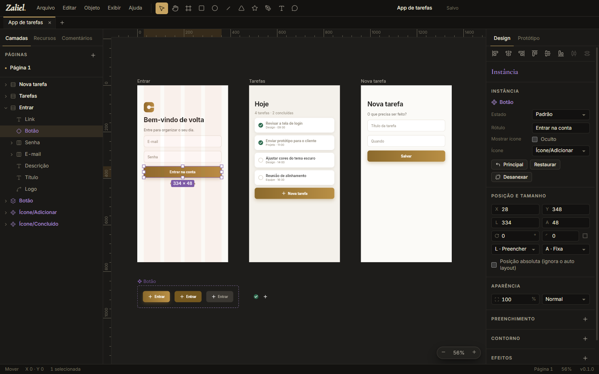
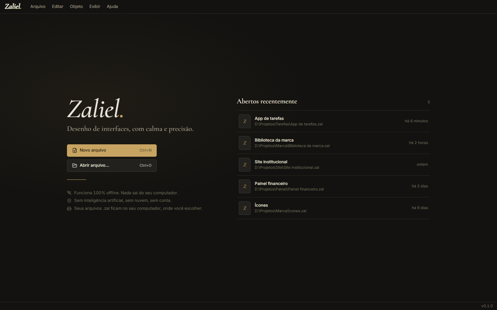
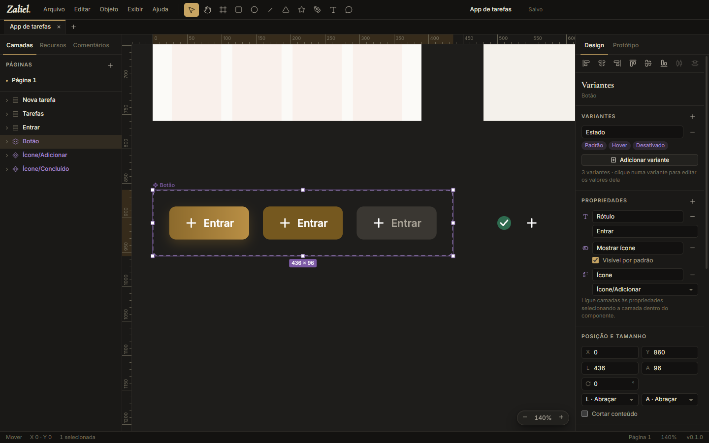
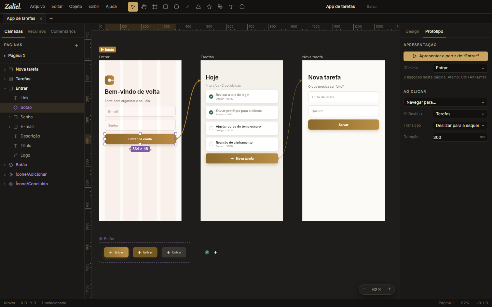
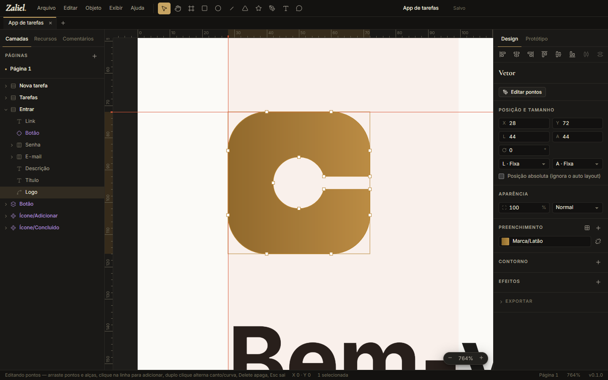

<p align="center">
  
</p>

<h1 align="center">Zaliel</h1>

<p align="center"><em>Desenho de interfaces, com calma e precisão.</em><br/>
Editor de UI para desktop — 100% offline, sem inteligência artificial, sem nuvem, sem conta.</p>

<p align="center">
  
</p>

## O que é

O Zaliel é um editor de interfaces feito para quem não pode (ou não quer) usar ferramentas online ou com IA. Tudo roda no seu computador, e os documentos ficam em arquivos próprios, com extensão **`.zal`**.

| | |
|---|---|
|  |  |
|  |  |

## Recursos

- **Canvas com Skia (CanvasKit/WebAssembly)** — o mesmo motor gráfico do Chrome: pan, zoom de 2% a 25.600%, grade de pixels.
- **Ferramentas**: mover, mão, frame, retângulo, elipse, linha, polígono, estrela, caneta (curvas Bézier) e texto.
- **Edição**: seleção por clique ou retângulo, multisseleção, mover, redimensionar (Shift mantém proporção, Alt a partir do centro), girar, alt+arrastar para duplicar, encaixe inteligente com guias, setas para mover.
- **Auto layout** (flexbox): direção, quebra de linha, espaçamento, margens, alinhamento 3×3, *space-between*, filhos que abraçam ou preenchem, posição absoluta.
- **Constraints** (esquerda, direita, centro, esticar, escala) em frames sem auto layout.
- **Aparência**: vários preenchimentos (sólido, gradiente linear/radial/angular, imagem), contornos (dentro, centro, fora, tracejado), raio de canto individual, opacidade e 16 modos de mesclagem.
- **Efeitos**: sombra externa, sombra interna, desfoque da camada e desfoque do fundo.
- **Texto**: fontes embutidas (Inter) e **todas as fontes instaladas no computador**, peso, itálico, tamanho, altura de linha, espaçamento, alinhamento, caixa, sublinhado/tachado, largura automática.
- **Componentes e instâncias**: crie componentes, use instâncias, edite textos por instância (overrides), restaure, desanexe, vá ao principal.
- **Variantes e propriedades de componente**: combine componentes num conjunto de variantes (ex.: Estado = Padrão/Hover) e crie propriedades booleanas, de texto e de troca de instância que as instâncias mudam sem desanexar.
- **Operações booleanas**: unir, subtrair, interseção e excluir, com as formas originais editáveis dentro; converter em vetor quando quiser (várias formas viram um vetor só, e textos viram o contorno das letras).
- **Edição de pontos de vetores**: duplo clique num vetor abre os pontos e as alças — arraste, adicione pontos clicando na linha, alterne canto/curva com duplo clique, apague com Delete.
- **Réguas, guias e grades de layout**: arraste guias a partir das réguas (com encaixe) e adicione colunas, linhas ou grade quadrada aos frames.
- **Estilos de cor, texto e efeito** reutilizáveis: editar um estilo atualiza todas as camadas que o usam (e eles vão junto nas bibliotecas).
- **Protótipo**: ligue camadas a outros frames ao clicar, abra frames por cima da tela (modais, menus, folhas de baixo, com fundo escurecido e fechar ao clicar fora), escolha a transição e apresente em tela cheia.
- **Bibliotecas**: use os componentes e variáveis de outro arquivo `.zal`. Uma cópia fica dentro do arquivo (funciona offline e sozinho). O Zaliel avisa quando a biblioteca de origem mudou.
- **Variáveis com modos** (ex.: claro/escuro) para cores, números, textos e booleanos. Ligue cores a variáveis e troque o modo para ver o arquivo inteiro mudar.
- **Páginas**, camadas com arrastar e soltar, renomear, ocultar e bloquear.
- **Vários arquivos em abas** na mesma janela (Ctrl+Tab troca, arraste para reordenar, clique do meio fecha).
- **Localizar e substituir** (Ctrl+F) em textos, nomes de camadas e textos de instâncias, numa página ou no arquivo todo.
- **Comentários** no canvas (ferramenta C): conversas com respostas, resolver/reabrir e a lista de tudo na aba Comentários.
- **Histórico de versões** dentro do próprio arquivo: versões com nome, versões automáticas ao salvar, restaurar ou abrir como cópia.
- **Espelhar** na horizontal e na vertical (Shift+H, Shift+V) e **texto em caminho** (selecione um texto e uma forma).
- **Exportação** em PNG, JPG, WebP (0,5× a 4×), SVG e PDF (uma página por frame), e **exportação de várias telas de uma vez** para uma pasta, com padrão de nomes (`{pagina}/{n} - {nome}`) e várias escalas.
- **Importação de imagens** por arquivo, arrastar e soltar ou colar.
- **Importar arquivos de design** (**Arquivo → Importar arquivo…** ou arrastar para o canvas): páginas, camadas, componentes e variantes, variáveis com modos, estilos, auto layout, vetores, imagens e ligações de protótipo viram um documento `.zal` editável. Ao final, o app avisa as fontes que faltam e o que não pôde ser convertido. Arquivos grandes são lidos em segundo plano, sem travar a janela.
- **Segurança do trabalho**: salvamento automático (opcional), cópia de recuperação a cada 20 segundos (o app oferece recuperar após uma falha), gravação atômica (o arquivo não corrompe se faltar luz), aviso antes de fechar com alterações.
- **Tema claro e escuro**, atalhos de teclado e menus completos.

## Sem internet, de verdade

- Toda requisição de rede da interface é **bloqueada** no processo principal do Electron.
- Fontes, motor gráfico e ícones vão **dentro** do instalador.
- A única conexão possível é **Ajuda → Verificar atualizações**, e só quando o usuário clica. O app nunca verifica sozinho.

## Arquitetura

Monorepo em TypeScript (npm workspaces):

| Pacote | O que faz |
|---|---|
| `packages/core` | Modelo do documento, schema do `.zal`, operações com desfazer/refazer, auto layout, componentes, variáveis, exportação SVG/PDF e conversão de arquivos importados. Sem interface e sem rede. |
| `packages/renderer` | Desenho com Skia (CanvasKit) e fontes. |
| `packages/editor` | Interface do editor em React (canvas, painéis, menus, diálogos). |
| `apps/desktop` | O aplicativo Electron: janelas, arquivos, recuperação, bloqueio de rede, atualização sob demanda. |

Toda alteração no documento é uma **operação** (`set`, `insert`, `remove`, `move`…). É isso que dá desfazer/refazer.

## Desenvolvimento

```bash
npm install
```

```bash
npm run dev
```

```bash
npm test
```

```bash
npm run check
```

Gerar o instalador do Windows localmente:

```bash
npm run dist:win -w @zaliel/desktop
```

Gancho de testes: `--user-data=<pasta>` usa um perfil separado (configurações, recentes e recuperação).

## Atualizações

O Zaliel nunca se conecta sozinho. Em **Ajuda → Verificar atualizações**:

| Instalação | Comportamento |
|---|---|
| Windows (instalador) e Linux AppImage | Baixa dentro do app (com progresso) e instala ao reiniciar. |
| macOS, Windows portátil, Linux .deb/.rpm | Abre a página da versão para baixar. |

## Publicar uma versão

1. **Actions → Release → Run workflow** e escolha `patch`, `minor` ou `major` (ou `teste` para só gerar os builds).
2. O workflow checa tipos e testes, gera os instaladores (Windows x64/ARM, macOS Apple Silicon/Intel, Linux x64/ARM), grava a versão nova, cria a tag e publica a release com a tabela de downloads e as somas SHA-256.

Os arquivos seguem o padrão `Zaliel-<versão>-<sistema>-<arquitetura>`.

## Licença

MIT — veja [LICENSE](LICENSE). Uso livre, inclusive comercial, para o editor e para os arquivos criados com ele. Componentes de terceiros mantêm as próprias licenças (Skia: BSD-3; opentype.js: MIT; Inter e Cormorant Garamond: OFL 1.1).
