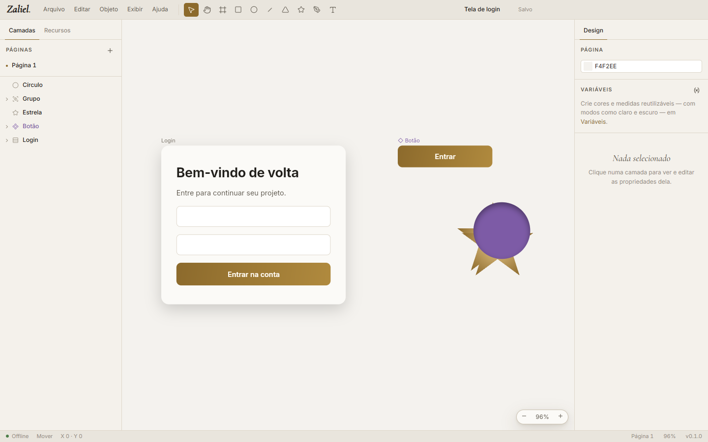
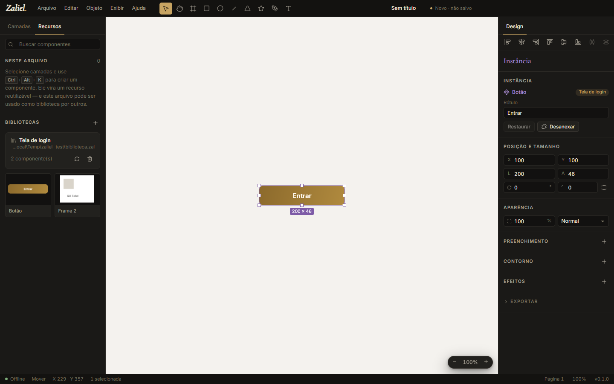

<p align="center">
  
</p>

<h1 align="center">Zaliel</h1>

<p align="center"><em>Desenho de interfaces, com calma e precisão.</em><br/>
Editor de UI para desktop — 100% offline, sem inteligência artificial, sem nuvem, sem conta.</p>

<p align="center">
  
</p>

## O que é

O Zaliel é um editor de interfaces no estilo do Figma e do pen.dev, feito para quem não pode (ou não quer) usar ferramentas online ou com IA. Tudo roda no seu computador. Os arquivos têm extensão própria, **`.zal`**, mas por dentro são **JSON legível**: abra no Bloco de Notas ou no VS Code e o conteúdo está lá.

| | |
|---|---|
|  |  |

## Recursos

- **Canvas com Skia (CanvasKit/WebAssembly)** — o mesmo motor gráfico do Chrome: pan, zoom de 2% a 25.600%, grade de pixels.
- **Ferramentas**: mover, mão, frame, retângulo, elipse, linha, polígono, estrela, caneta (curvas Bézier) e texto.
- **Edição**: seleção por clique ou retângulo, multisseleção, mover, redimensionar (Shift mantém proporção, Alt a partir do centro), girar, alt+arrastar para duplicar, encaixe inteligente com guias, setas para mover.
- **Auto layout** (flexbox): direção, quebra de linha, espaçamento, margens, alinhamento 3×3, *space-between*, filhos que abraçam ou preenchem, posição absoluta.
- **Constraints** (esquerda, direita, centro, esticar, escala) em frames sem auto layout.
- **Aparência**: vários preenchimentos (sólido, gradiente linear/radial/angular, imagem), contornos (dentro, centro, fora, tracejado), raio de canto individual, opacidade e 16 modos de mesclagem.
- **Efeitos**: sombra externa, sombra interna, desfoque da camada e desfoque do fundo.
- **Texto**: fontes embutidas (Inter) e **todas as fontes instaladas no computador**, peso, itálico, tamanho, altura de linha, espaçamento, alinhamento, caixa, sublinhado/tachado, largura automática.
- **Componentes e instâncias**: crie componentes, use instâncias, edite textos por instância (overrides), restaure, desanexe, vá ao principal.
- **Bibliotecas**: use os componentes e variáveis de outro arquivo `.zal`. Uma cópia fica dentro do arquivo (funciona offline e sozinho). O Zaliel avisa quando a biblioteca de origem mudou.
- **Variáveis com modos** (ex.: claro/escuro) para cores, números, textos e booleanos. Ligue cores a variáveis e troque o modo para ver o arquivo inteiro mudar.
- **Páginas**, camadas com arrastar e soltar, renomear, ocultar e bloquear.
- **Exportação** em PNG, JPG, WebP (0,5× a 4×) e SVG.
- **Importação de imagens** por arquivo, arrastar e soltar ou colar.
- **Segurança do trabalho**: cópia de recuperação a cada 20 segundos (o app oferece recuperar após uma falha), gravação atômica (o arquivo não corrompe se faltar luz), aviso antes de fechar com alterações.
- **Tema claro e escuro**, atalhos de teclado iguais aos do Figma e menus completos.

## Sem internet, de verdade

- Toda requisição de rede da interface é **bloqueada** no processo principal do Electron.
- Fontes, motor gráfico e ícones vão **dentro** do instalador.
- A única conexão possível é **Ajuda → Verificar atualizações**, e só quando o usuário clica. O app nunca verifica sozinho.

## O arquivo `.zal`

```json
{
  "format": "zaliel",
  "version": 1,
  "id": "74f4g95k2ncd2a1t",
  "name": "Tela de login",
  "pages": [
    {
      "id": "p1", "name": "Página 1", "background": "#f4f2ee",
      "children": [
        {
          "id": "a1", "type": "frame", "name": "Login",
          "x": 0, "y": 0, "width": 390, "height": 336,
          "fills": [{ "type": "solid", "color": "#fbfaf7" }],
          "layout": { "direction": "vertical", "gap": 16, "padding": [40, 32, 40, 32], "justify": "start", "align": "stretch" },
          "children": [
            { "id": "t1", "type": "text", "name": "Título", "text": "Bem-vindo de volta", "x": 32, "y": 40, "width": 326, "height": 34,
              "autoResize": "height", "style": { "family": "Inter", "weight": 700, "size": 28 } }
          ]
        }
      ]
    }
  ],
  "variables": [],
  "libraries": [],
  "assets": {}
}
```

Especificação completa: [docs/FORMATO.md](docs/FORMATO.md).

## Arquitetura

Monorepo em TypeScript (npm workspaces):

| Pacote | O que faz |
|---|---|
| `packages/core` | Modelo do documento, schema do `.zal`, operações com desfazer/refazer, auto layout, componentes, variáveis, exportação SVG. Sem interface e sem rede. |
| `packages/renderer` | Desenho com Skia (CanvasKit) e fontes. |
| `packages/editor` | Interface do editor em React (canvas, painéis, menus, diálogos). |
| `apps/desktop` | O aplicativo Electron: janelas, arquivos, recuperação, bloqueio de rede, atualização sob demanda. |

Toda alteração no documento é uma **operação** (`set`, `insert`, `remove`, `move`…). É isso que dá desfazer/refazer, e é a mesma porta que outros aplicativos podem usar no futuro para ler e gravar arquivos `.zal`.

## Desenvolvimento

```bash
npm install
```

```bash
npm run dev
```

```bash
npm test
```

```bash
npm run check
```

Gerar o instalador do Windows localmente:

```bash
npm run dist:win -w @zaliel/desktop
```

Gancho de testes: `--user-data=<pasta>` usa um perfil separado (configurações, recentes e recuperação).

## Atualizações

O Zaliel nunca se conecta sozinho. Em **Ajuda → Verificar atualizações**:

| Instalação | Comportamento |
|---|---|
| Windows (instalador) e Linux AppImage | Baixa dentro do app (com progresso) e instala ao reiniciar. |
| macOS, Windows portátil, Linux .deb/.rpm | Abre a página da versão para baixar. |

## Publicar uma versão

1. **Actions → Release → Run workflow** e escolha `patch`, `minor` ou `major` (ou `teste` para só gerar os builds).
2. O workflow checa tipos e testes, gera os instaladores (Windows x64/ARM, macOS Apple Silicon/Intel, Linux x64/ARM), grava a versão nova, cria a tag e publica a release com a tabela de downloads e as somas SHA-256.

Os arquivos seguem o padrão `Zaliel-<versão>-<sistema>-<arquitetura>`.

## Licença

Proprietária — veja [LICENSE](LICENSE). Componentes de terceiros mantêm as próprias licenças (Skia: BSD-3; Inter e Cormorant Garamond: OFL 1.1).
